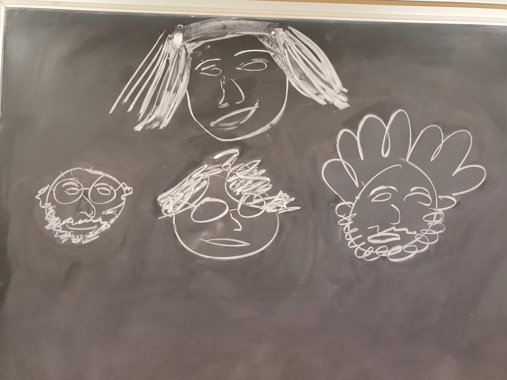

    

        
    

    

        
Kyungtak Brian Hong 홍경탁

        <a href="mailto:hong420@purdue.edu">hong420@purdue.edu</a>
        
Ph.D. Candidate in Mathematics, Purdue University

    

## About Me

I am a Ph.D. candidate in the Department of Mathematics at Purdue University, advised by [Prof. Oleksandr Tsymbaliuk](https://www.math.purdue.edu/~otsymbal/). Prior to joining Purdue in 2022, I received my B.S. in Mathematical Sciences and Physics and completed Master's coursework in Mathematical Sciences at Seoul National University.

* **Curriculum Vitae:** [Download PDF](/files/CV_Kyungtak_Hong.pdf)

## Research Interests

My primary research areas are **representation theory** and **mathematical physics**, with connections to quantum integrable systems and low-dimensional topology. In particular:

* **Quantum (super)groups and their representations:** Explicit Hopf superalgebra isomorphisms among Drinfeld–Jimbo, new Drinfeld, and RLL realizations; universal and evaluated *R*-matrices uniform across arbitrary parity sequences.
* **Categorical and structural quantization paradigms:** Nichols algebras, tensor categories, Etingof–Kazhdan quantization, and categorification via quiver Hecke (KLR) (super)algebras.

## Contact

* **Email:** [hong420@purdue.edu](mailto:hong420@purdue.edu)
* **Address:** Department of Mathematics, Purdue University, 150 N. University Street, West Lafayette, IN 47907, USA

  
  

    Chalkboard portrait drawn by <a href="https://sites.google.com/view/estepan-ashkarian/home" target="_blank" style="white-space: nowrap;">Estepan Ashkarian</a>. 
    Top: <a href="https://alexanderhsu.com/" target="_blank">Alex Hsu</a>. 
    Bottom: Estepan, me, <a href="https://cagrinso-github-io.vercel.app" target="_blank">Carlos Agrinsoni</a>.
  

Last updated: November 11, 2026
