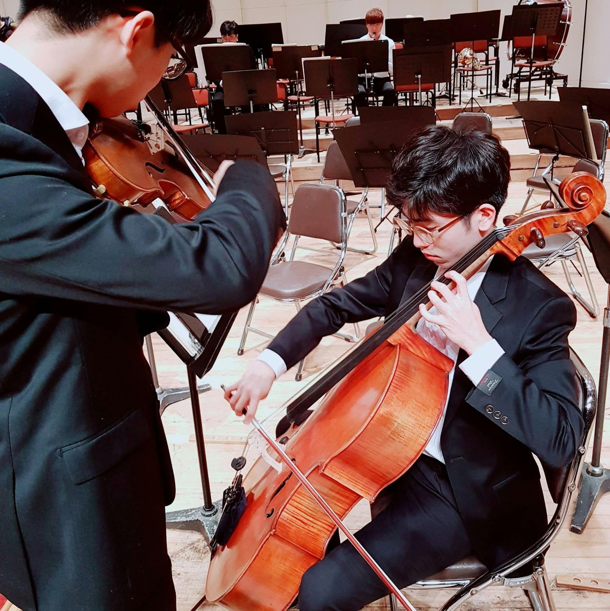

## Music

  
  

    Running through a passage with the concertmaster, Changhwan Oh  
    (a close friend since high school), at SNUPO.
  

### Cello
* During my undergraduate years at Seoul National University, I was an active member of the Seoul National University Philharmonic Orchestra (SNUPO), where I also served as the principal cellist.
* My favorite orchestral piece is the third movement (*Allegro molto vivace*) of Tchaikovsky's Symphony No. 6 in B minor (*Pathétique*), Op. 74.

### Piano
* While I started playing earlier, I have developed a much deeper interest in the piano during my graduate studies at Purdue and enjoy practicing it in my spare time.
* My favorite piano piece is the second movement (*Adagio cantabile*) of Beethoven's Piano Sonata No. 8 in C minor, Op. 13—another *Pathétique*, for some inexplicable reason.

### Beyond Classical
* Outside of classical repertoire, I am a big fan of EDM and electronic pop—my current favorite track is *Roses* by The Chainsmokers.

Last updated: November 11, 2026
